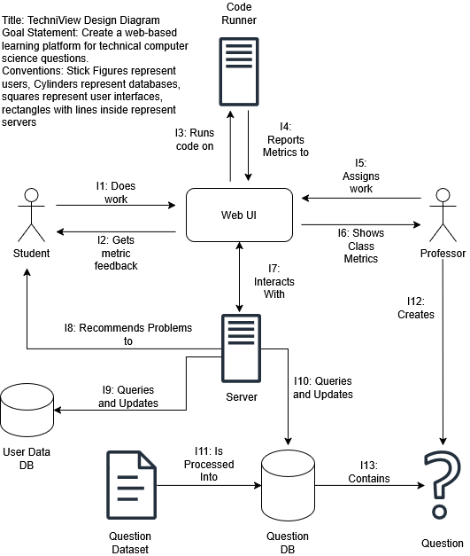
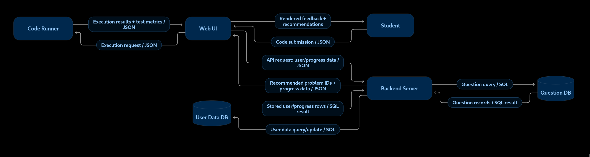
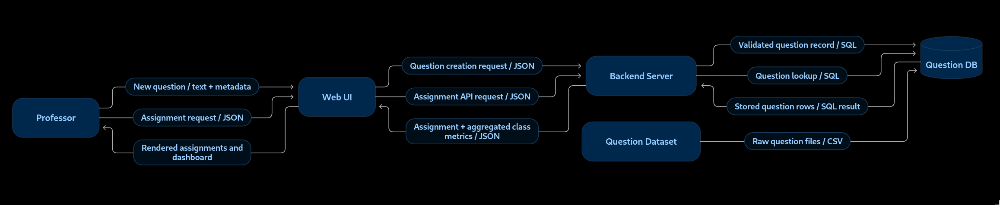

# TechniView D0: High-level system design

## Title, goal statement, and conventions

Title: TechniView Design Diagram

Goal Statement: Create a web-based learning platform for technical
computer science questions.

Conventions: Stick Figures represent users, Cylinders represent
databases, squares represent user interfaces, rectangles with lines
inside represent servers

Implementation note: The User Data DB and Question DB cylinders show logical data groups. The current deployment stores both groups in the platform MySQL database. The separate go-judge service executes code without a database or queue.

## Block diagram

**Figure D0.1. TechniView Design Diagram.** Goal: create a web-based learning platform for technical computer science questions. Stick figures represent users, cylinders represent logical data groups, squares represent interfaces, and lined rectangles represent servers.

## Component responsibility table

|  |  |  |  |  |
|----|----|----|----|----|
| Component | Responsibility | Interfaces In | Interfaces Out | Owner |
| User Data DB | Maintains all user data | Backend Server | Backend Server | Jason Bellerjeau |
| Question DB | Stores all question data | Backend Server, Question Dataset | Backend Server | Jason Bellerjeau |
| Backend Server | Handles queries to databases | Web UI, User Data DB, Question DB | Web UI, User Data DB, Question DB | Derek Corniello |
| Web UI | Handles interaction with user | Backend Server, Code Runner | Backend Server, Code Runner | Ryan Sippy |
| Code Runner | Runs each problems code | Web UI | Web UI | Derek Corniello |

## Interface specification table

|  |  |  |  |  |  |  |  |
|----|----|----|----|----|----|----|----|
| Interface | Input | Output | Data Format | Protocol | On Error | Handling Component | Ex. Payload |
| I1 | Student interaction | Submission to Web UI | JSON | HTTPS | Display UI Error Message | Web UI | {“student_id”: 1, “code”:”print(‘hello’)”} |
| I2 | Metrics from Web UI | Visual Feedback | JSON | HTTPS | Display system error | Student Client | {“status”: “pass”} |
| I3 | Execution request | Code sent to runner | JSON | REST | Return Error | Code Runner | {“source_code”: “...”} |
| I4 | Results from runner | Metrics sent to Web UI | JSON | REST | Log failure | Web UI | {“tests_passed”: 5} |
| I5 | Assignments from Professor | Assignments sent to Web UI | JSON | HTTPS | Display error in UI | Web UI | {“assignment_id” : 1, “problem_id” : Q101} |
| I6 | Aggregated Data | Rendered Dashboard | JSON | HTTPS | Display Data Unavailable error | Professor Client | {"avg_score": 88.5, "completion": 0.95} |
| I7 | API requests | API response | JSON | HTTPS | Return HTTP codes | Server | {"action": "fetch_assignments"} |
| I8 | Performance Data | Suggestions | JSON | HTTPS | Return recommendation error | Server | {"recommended_ids": \["Q10", "Q12"\]} |
| I9 | User Data request | User Data results | SQL | TCP | Log DB error | User Data DB | “SELECT \* FROM users WHERE id='101';” |
| I10 | Read/Write requests | Question data | SQL | TCP | Log DB Error | Question DB | “SELECT prompt FROM questions WHERE id='Q1';” |
| I11 | Raw question files | Database records | CSV, SQL | Script | Halt Pipeline | Question DB | \[{"id":"Q1", "text":"Sort array"}\] |
| I12 | Text question input | Database record | Text | HTTPS | Display Error on client | Web UI/Server | {"title": "Binary Tree", "difficulty": "Hard"} |
| I13 | Database record | Question | SQL | TCP | Throw error | Server | Question(id="Q1", type="Algorithm") |

## Data flow diagrams

**Figure D0.2. TechniView Design Diagram.** Goal: create a web-based learning platform for technical computer science questions. Boxes name services or actors, arrows show data flow, and arrow labels name the exchanged data.

**Figure D0.3. TechniView Design Diagram.** Goal: create a web-based learning platform for technical computer science questions. Boxes name services or stores, arrows show data flow, and arrow labels name the exchanged data.

## Architecture pattern and justification

The system is a combination of client-server, microservices, and
pipeline architectural patterns. The primary interaction for the users
is governed by a client-service pattern, with the Web UI being the
client communicating with backend servers. The backend is governed by
microservices with the general backend server being separated from the
code runner. We chose to separate them because it was the right “fit to
the problem”. Isolating the code runner ensures that malicious code does
not impact the main server or web UI. Finally, we chose to use a
pipeline to govern the data ingestion process to process the question
dataset into the question DB. We rejected an embedded sensor-actuator
pattern because that is primarily for hardware systems, whereas our
systems is entirely web-based, so it is not the right fit.

## Decision log

|  |  |  |
|----|----|----|
| Decision | Alternatives Considered | Reasoning |
| Use a web-based client-server architecture | Desktop application with monolithic local application | A web application allows students and professors to access TechniView without installing software. The Web UI can handle UI/UX while the Backend Server has logic and database access. |
| Separate the Code Runner from the Backend Server | Execute submitted code directly on the Backend Server and execute code in the browser | The Code Runner isolates student-submitted code from the primary application server. This reduces the risk that incorrect or malicious code can affect the Server or UI and allows code execution to be managed independently in a containerized environment. |
| Use separate User Data and Question databases | Store all application data in one database and store question data in static files | User progress and question content serve different purposes and have different usage patterns. Separating them keeps their responsibilities clear and allows each data source to be queried and maintained independently. |
| Use JSON/REST for application communication | Direct database access from the Web UI, and/or custom binary protocol with form-encoded messages | JSON over HTTP/REST is simple to implement in a web application, easy to inspect during development, and provides a clear interface between the UI, Backend Server, and Runner. |
| Use a question-ingestion pipeline for dataset questions | Enter every question manually, allow the application to read raw dataset files directly | A pipeline takes raw questions into a consistent database representation before they are used by the app. This keeps data processing separate from application requests and prevents the Backend Server from repeatedly parsing inputs. |
