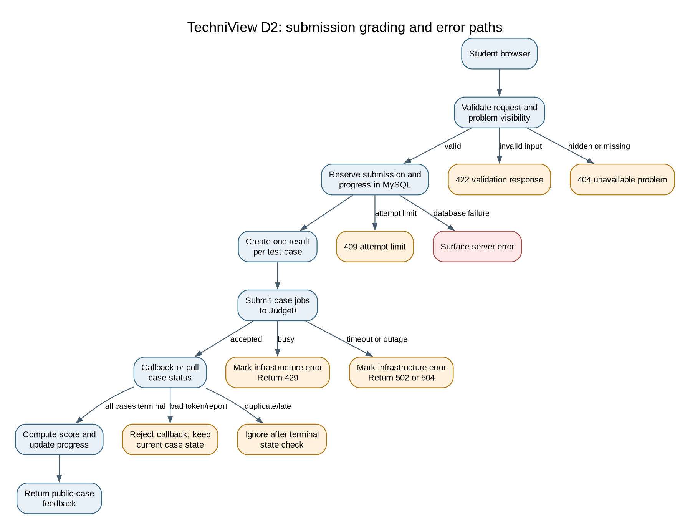

# TechniView D2: Detailed design

> Historical design snapshot. The current runner is standalone go-judge; see
> [runner decision](../runner-decision.md) and [deployment](../deployment.md).

## Header, conventions, and D2 overview

**Project title:** TechniView Design Diagram  
**Goal statement:** Create a web-based learning platform for technical computer science questions.

**Diagram conventions:** Actors are stick figures. Rounded boxes are browser or application components. Rectangles are services. Cylinders are persistent stores. Arrows show request or data flow; arrows labeled with an error show failure paths. In data models, boxes name MySQL tables, lines show foreign-key relationships, PK means primary key, FK means foreign key, and UQ means a unique constraint. An item marked “no persistent data” owns no application table.

**Two-minute overview.** TechniView is a course-linked coding practice platform. Students browse Python problems, submit code, see test results, and review their progress. Professors manage courses, curate problems, build question sets, publish assignments, review submissions, and view analytics. The FastAPI backend stores application data in MySQL. It sends isolated code jobs to the internal Judge0 fork. Judge0 uses its own PostgreSQL and Redis. D1 designed the grading and progress data model, the grading and aggregation algorithms, and selected API contracts. D2 accounts for the rest of the current backend, frontend, operations, and integration boundaries, then records risks and open questions.

The repository implements many of these flows, but implementation status varies by component. The React app has login, student, and teacher routes. Problem authoring, assignments, and class workflows have backend APIs, but the visible pages are not a complete workflow for every API. Notification delivery does not exist. The backend has no application-owned audit log or structured logging policy. Health endpoints probe dependencies, but they are not an alerting system.

**Known gaps and open questions**

- The user stories name privacy and regulatory compliance, but no jurisdiction, retention schedule, consent rule, or acceptance threshold is specified.
- Production cookie security is configurable and defaults to false. Production CORS origins, HTTPS termination, secret management, backups, and restore targets are not defined in this repository.
- No notification service or notification preferences exist. Assignment publication and late approval do not send messages.
- No session cleanup job, rate limiting, account recovery flow, or MFA exists.
- Course membership removal is a soft withdrawal. Assignment recipients are snapshotted at assignment creation, and analytics can continue to include a withdrawn recipient.
- Large analytics queries load records and slice after grouping. Pagination is not pushed into the database.
- The public frontend does not expose all backend workflows. Some teacher and student routes are present, but product completeness and accessibility have not been audited.
- The companion peer review notes record a positive review of the design and list a few low-priority implementation follow-ups.

## Finished components, the D2 diagrams

### Current component map

| Component | Current data model | Current behavior | Interface |
|---|---|---|---|
| Browser clients | No persistent data. React state only. | Auth provider checks the session; role routes direct students and professors to their pages. Pages call the API with cookies. | React routes listed below; HTTPS/JSON in deployment. |
| Authentication | User, UserSession. | Scrypt password verification; random session token returned in an HTTP-only cookie; only its SHA-256 hash is stored. Sessions expire after configured days and logout revokes them. | POST /api/auth/login, POST /api/auth/logout, GET /api/auth/me. |
| Course and membership | Course, CourseMembership. | Join links enroll or reactivate students. Staff can view rosters, change roles, and withdraw members. The last active instructor cannot be demoted or removed. | GET /api/courses, GET /api/courses/{course_id}, GET /api/courses/{course_id}/members, PATCH and DELETE member routes, GET /api/join/{token}, POST signup/login routes. |
| Problem catalog and curriculum | Problem, ProblemTestCase, ProblemTag, problem_tag_assignments, CurriculumNode. | Published problems are browsable under visibility rules. Public examples are returned; hidden cases and canonical solutions are withheld. Curriculum is derived from problem tags and progress. | GET /api/problems, GET /api/problems/{problem_id}, POST /api/problems/{problem_id}/start, GET /api/curriculum, GET /api/curriculum/available. |
| Problem authoring and question sets | Problem, ProblemTestCase, ProblemTag, QuestionSet, QuestionSetItem. | Professors create and edit owned drafts, copy visible problems, validate the canonical solution against every case, then publish or archive. Question-set items are replaced as an ordered list. | POST/PATCH /api/problems, POST copy/validate/publish/archive routes, GET/POST/PATCH /api/question-sets, PUT items, POST publish/archive. |
| Assignment management | Assignment, AssignmentItem, AssignmentRecipient; D1 data model. | A published owned question set is copied into a draft assignment. Active student memberships become recipients. Instructors publish non-empty drafts. Students see published, available assignments addressed to them. | POST /api/courses/{course_id}/assignments, POST publish, GET list and detail routes. |
| Submission grading and progress | Submission, SubmissionCaseResult, StudentAssignmentProgress, StudentPracticeProgress; detailed in D1. | The API reserves a submission, creates one Judge0 job per case, consumes callback or polling results, computes score and terminal status, then updates progress. | POST/GET /api/submissions, internal Judge0 callback route, staff submission routes under /api/courses/{course_id}/submissions. |
| Analytics | Student and assignment progress tables; detailed in D1. | Student and staff reads aggregate progress, errors, completion, and retries. Staff endpoints require instructor or TA membership. | GET /api/me/analytics, course overview, problem, and student-problem analytics routes. |
| API runtime and configuration | No persistent data. Environment variables configure MySQL, Judge0, cookie policy, CORS, and Judge0 callback URL. | FastAPI mounts routers under /api, applies CORS, dependency checks, and shared validation/API-error handlers. | JSON over HTTP; OpenAPI at /api/docs. |
| Platform persistence | MySQL tables described above. The logical User Data DB and Question DB are not separate MySQL services. | SQLAlchemy sessions and Alembic migrations read and write application data. Foreign keys, unique constraints, and transactions enforce relationships. | Internal SQL connections only. |
| Code runner | No TechniView application tables. Judge0 owns PostgreSQL and Redis state. | The internal Judge0 fork runs Python submissions in workers with per-job CPU and memory limits. Callback delivery returns case outcomes. | Internal Judge0 REST submission/status endpoints and TechniView callback endpoint. |
| Health and operational checks | No persistent application data. | Health handlers probe MySQL, Judge0, Judge0 PostgreSQL, and Redis. Deep Judge0 check submits a small Python program. No alert routing or structured application log store is present. | GET /api/health, /api/health/{mysql,postgres,redis,judge0}. |
| Logging | No persistent data. Uvicorn process output only; no application audit log table or configured log sink. | Uvicorn can write access/runtime output to process streams. Business actions and security events are not recorded in an application-owned log. | Process stdout/stderr for the container runtime; no application logging API. |
| Notifications | No persistent data. Not implemented. | No email, push, or in-app delivery. Current behavior is to expose state through API reads and UI pages. | No notification endpoint or message bus. |

### Browser behavior and interfaces

The browser sends JSON requests with credentials included. Authentication uses the HTTP-only techniview_session cookie, not a bearer token. The frontend API wrapper throws a generic status error for non-success responses. Login displays a generic credential error. Protected routes redirect unauthenticated users to login and restrict teacher routes to professors.

The frontend currently exposes /login, /student/statistics, /student/problems, /student/problems/{problemId}, /teacher/class, /teacher/statistics, and /teacher/problems. The API surface is broader than those routes. The browser has no durable local data model. Browser refreshes recover the user via GET /api/auth/me.

### Persistence model added after D1

The following tables complete the parts of the current model not shown in D1. All are in the same platform MySQL schema.

| Table | Key fields and relationships | Purpose |
|---|---|---|
| User | id PK, name, email UQ, password_hash, role, disabled_at | Account identity and global role. |
| UserSession | id PK, token_hash UQ, user_id FK, created_at, last_used_at, expires_at, revoked_at | Hashed, expiring login sessions. |
| Course | id PK, name, description, timezone, join_code_hash UQ, archived_at | Course identity and hashed invite link. |
| CourseMembership | id PK, course_id FK, user_id FK, role, joined_at, withdrawn_at; course_id + user_id UQ | Per-course membership and withdrawal history. |
| Problem | id PK, owner_id FK, copied_from_id FK, origin, state, title, prompt, difficulty, execution_mode, function_name, starter_code, canonical_solution, resource limits, source attribution | Built-in and professor-authored problems. |
| ProblemTestCase | id PK, problem_id FK, case_order, visibility, input, expected_output; problem_id + case_order UQ | Ordered public and hidden test cases. |
| ProblemTag and problem_tag_assignments | ProblemTag id PK, name UQ, slug UQ, kind; assignment join has problem_id + tag_id PK | Search and curriculum classification. |
| CurriculumNode | problem_id PK/FK, priority UQ | Explicit problem order for the baseline curriculum. |
| QuestionSet | id PK, owner_id FK, title, description, state, created_at | Professor-owned ordered source for assignments. |
| QuestionSetItem | id PK, question_set_id FK, problem_id FK, item_order; set/order and set/problem UQ | Ordered question-set contents. |
| Assignment | id PK, course_id FK, assigned_by_membership_id + course_id composite FK, source_question_set_id FK, title, state, availability, due date | Course assignment lifecycle. |
| AssignmentItem | id PK, assignment_id FK, problem_id FK, item_order, points, submission_limit | Ordered assignment problems and grading limits. |
| AssignmentRecipient | assignment_id + membership_id PK, course_id; composite FKs to assignment and membership | Snapshot of students assigned at creation time. |

**State changes.** Problem: draft -> published -> archived; published problems cannot be edited, and copying creates a new draft. Question set: draft -> published -> archived; published content is immutable. Assignment: draft -> published; there is no archive route in the current API. Submission: queued -> running -> passed/failed/compile_error/runtime_error/timeout/resource_limit/infrastructure_error. A terminal submission does not accept later callback changes. Course membership moves between active and withdrawn; rejoining reactivates the same membership without changing its role.

### Backend interfaces

All routes below are mounted under /api. Request and response bodies are JSON unless the route sets or clears the session cookie or returns 204.

| Area | Routes | Inputs and outputs |
|---|---|---|
| Authentication | POST /auth/login, POST /auth/logout, GET /auth/me | Login takes email/password, sets the HTTP-only cookie, and returns User. Logout revokes the matching session if present, clears the cookie, and returns 204. Me returns the authenticated user. |
| Course join | GET /join/{token}, POST /join/{token}/signup, POST /join/{token}/login | Preview returns course summary. Signup takes name, email, password, confirmation. Login takes email/password. Successful signup/login enrolls and sets the session cookie. |
| Courses | GET /courses, GET /courses/{id}, GET /courses/{id}/members, PATCH /courses/{id}/members/{membership_id}, DELETE same member path | List/member routes accept bounded limit/offset. Role update accepts a membership role. Removal is soft withdrawal and returns 204. |
| Problem reads | GET /problems, GET /problems/{id}, POST /problems/{id}/start | List filters difficulty, tag, and pagination. Detail returns problem statement and public test cases only. Start records first-opened progress and returns 204. |
| Problem authoring | POST/PATCH /problems, POST /problems/{id}/copy, /validate, /publish, /archive | Draft payload includes title, prompt, difficulty, execution mode, function name, starter, optional canonical solution, limits, tags, and ordered cases. Publish validates the canonical solution through Judge0. |
| Question sets | GET/POST /question-sets, GET/PATCH /question-sets/{id}, PUT /question-sets/{id}/items, POST /publish, POST /archive | Professor-owned set; items request replaces ordered problem_ids. Duplicate or unavailable problems return a client error. |
| Assignments | POST /courses/{id}/assignments, POST /courses/{id}/assignments/{assignment_id}/publish, GET list/detail | Creation requires a published owned question set and title; optional available_at and due_at must be ordered. Publishing requires at least one item. |
| Submissions | POST /submissions, GET /submissions/{id} | POST takes problem_id, optional assignment_item_id, source_code, optional wait. Source is 1 to 65,535 UTF-8 bytes. GET is owner-only and polls Judge0 when results are not terminal. |
| Staff submissions | GET /courses/{id}/submissions, GET /courses/{id}/submissions/{submission_id}, POST /courses/{id}/submissions/{submission_id}/approve-late | Requires staff membership. Late approval records approving membership and timestamp. |
| Analytics | GET /me/analytics, GET /courses/{id}/analytics/overview, GET /courses/{id}/analytics/problems/{problem_id}, GET /courses/{id}/analytics/students/{student_id}/problems/{problem_id} | Optional difficulty/tag and assignment filters. Overview accepts limit 1..100 and offset >= 0. Staff reads require staff membership. |
| Curriculum | GET /curriculum, GET /curriculum/available | Optional kind selects technique or problem-type view. Returns pool metadata or available problem summaries for authenticated students. |
| Internal runner | PUT /internal/judge0/callbacks/{callback_token} | Judge0 posts a case report. Token is matched by hash; unknown or mismatched callback returns an error. This route is omitted from public OpenAPI. |
| Health | GET /health, /health/mysql, /health/postgres, /health/redis, /health/judge0 | Returns dependency status, latency, and limited version/diagnostic fields. Deep Judge0 health submits print(42). |

### D0 interface disposition

The old I1-I13 labels are conceptual D0 connections. The current interface below is narrower and avoids sending internal IDs, hidden test data, or SQL details to browser clients.

| D0 interface | Current boundary and contract | Revision |
|---|---|---|
| I1 Student interaction | Browser to authenticated API. POST /submissions accepts problem_id, optional assignment_item_id, and source_code. | The API derives student_id from the session rather than trusting a client-supplied identity. |
| I2 Metrics to student | API returns submission status, score, public case feedback, and GET /me/analytics metrics. | Keep hidden expected outputs and canonical solutions out of student responses. |
| I3 Execution request | Backend to internal Judge0 REST call, one job per test case with execution limits and callback URL. | Browser no longer calls the runner directly. Runner details stay behind the backend. |
| I4 Execution result | Judge0 callback posts a case report to the internal callback route; GET submission polls status as fallback. | Replace direct runner-to-browser metrics with authenticated backend state. |
| I5 Professor assignment | Professor creates an assignment from a published owned question_set_id with title and optional dates. | Problem list/order is copied from the question set; the caller does not supply arbitrary course membership or recipient IDs. |
| I6 Professor metrics | Staff calls course analytics overview/problem/student-problem routes. | Role and course membership are checked server-side; return aggregate fields rather than database rows. |
| I7 General API request | Browser uses JSON endpoints under /api with the HTTP-only session cookie. | Replace generic action payload with typed route-specific schemas and stable ApiError codes. |
| I8 Recommendations | GET /curriculum and /curriculum/available return pool metadata and available summaries using tags and progress. | Keep recommendation rules in the curriculum service; do not expose database queries. No personalized recommendation endpoint exists. |
| I9 User data access | Backend SQLAlchemy repository/session accesses application tables in MySQL. | SQL is internal and parameterized; browser never receives SQL or database credentials. |
| I10 Question data access | Backend SQLAlchemy repository/session reads and writes problem/question-set tables in the same platform MySQL schema. | Treat Question DB as a logical data group, not a separate deployed application database. |
| I11 Dataset import | Operator runs the catalog import command against a validated JSON catalog. | This is an offline operator workflow, not a client upload endpoint. |
| I12 Question authoring | Professor sends typed ProblemInput or QuestionSet input to authoring routes. | Canonical solution and hidden cases are professor-only; published content is immutable. |
| I13 Internal question object | Backend services pass SQLAlchemy Problem/ProblemTestCase records and response projections internally. | ORM objects are not exposed as a public wire format; response schemas select allowed fields. |

### Shared error contract and handler

Request schema errors and application ApiError responses use {error: {code, message, details}}. Validation errors return 422 with field diagnostics. Authentication failures return 401. Role or membership failures return 403 or conceal a resource as 404. Missing resources return 404; invalid lifecycle transitions and attempt limits return 409. Runner timeouts return 504, busy responses return 429, and other runner failures return 502. Runner failures mark the affected case as infrastructure_error; they do not count as a valid student attempt. The shared handler is install_error_handlers in backend/app/core/errors.py. Direct HTTPException paths, including internal callback errors and runner failures, use FastAPI's detail response instead.

### Grading flow, including failure paths

Student browser -> POST /api/submissions -> validate code and visibility -> reserve Submission and progress row in MySQL -> create one SubmissionCaseResult per case -> submit each case to Judge0 -> callback or owner polling updates each case -> finalize score and progress -> return public-case messages.

The diagram shows the failure outcomes as well as the successful path:

**Figure 1. TechniView D2 grading and error paths.** Project title: TechniView Design Diagram. Goal: create a web-based learning platform for technical computer science questions. Conventions: boxes are steps or services, arrows show request/data flow, and labeled arrows show failures and their handlers. These conventions apply to every D2 flow diagram.

~~~mermaid
flowchart TD
    A[Student browser] --> B[Validate request and problem visibility]
    B -->|invalid input| V[422 validation response]
    B -->|hidden or missing problem| N[404 response]
    B -->|valid| C[Reserve submission and progress in MySQL]
    C -->|attempt limit| L[409 response]
    C -->|database failure| DB[Surface server error]
    C --> D[Create one result per test case]
    D --> E[Submit case jobs to Judge0]
    E -->|busy| R[Mark infrastructure error and return 429]
    E -->|timeout or unavailable| X[Mark infrastructure error and return 504 or 502]
    E -->|accepted| F[Wait for callback or poll status]
    F -->|bad callback token/report| Q[Reject callback; retain current case state]
    F -->|duplicate or late callback| I[Ignore after terminal-state check]
    F -->|all cases terminal| G[Compute score and update progress]
    G --> H[Return result with public case feedback]
~~~

Failure branches:

- Invalid body or source length -> validation handler -> 422; student corrects the request.
- Hidden or unavailable problem -> visibility handler -> 404; no submission is created.
- No cases or attempt limit reached -> submission handler -> 409; professor must repair the problem or student must stop submitting.
- Judge0 busy -> mark case infrastructure error -> return 429; student may retry.
- Judge0 timeout or unavailable -> mark case infrastructure error -> return 504 or 502; student may retry after service recovery.
- Bad callback token or malformed report -> callback handler rejects report; valid callbacks can still complete the case.
- Duplicate or late callback -> row lock and terminal-state check keep the finalized grade unchanged.
- MySQL failure -> transaction fails and the API surfaces a server error; no automatic database retry is implemented.

## Edge cases and error handling

This risk-focused table has 12 scenarios grouped across three architecture areas. Each area covers the four class categories. Component names are grouped where the same failure path crosses their interfaces. The table prioritizes high-impact cases; it does not enumerate every low-risk variation for every component.

| ID | Component | Category | Edge case | Design decision |
|---|---|---|---|---|
| EC-01 | Browser clients; Authentication; Course membership | Boundary values | A protected request has an expired/revoked session, a join token is unknown, or a course would lose its last instructor. | Return 401 for invalid sessions, 404 for unknown tokens, and 409 for removing the last instructor. Handler: `get_current_user`, join route, and membership route. Recoverable: yes, sign in again or correct course membership. |
| EC-02 | Browser clients; Authentication; Course membership | Timing and concurrency | Logout races with an authenticated request, or two staff members remove/demote the last instructor concurrently. | Requests authenticated before revocation may finish; serialize instructor changes in one transaction. Handler: session lookup and course membership service. Recoverable: yes; retry after a conflict. Membership serialization is a design follow-up. |
| EC-03 | Browser clients; Authentication; Course membership | Bad or missing input | Credentials/signup fields are invalid, or a student requests a staff-only course operation. | Return generic 401 for bad credentials, 422 for malformed fields, and 403/404 for unauthorized or concealed resources. Handler: auth routes, FastAPI validation, and membership authorization. Recoverable: yes, correct input or access. |
| EC-04 | Browser clients; Authentication; Course membership; API runtime/configuration | External dependencies | API or MySQL is unavailable during login, enrollment, or a protected page request. | Roll back writes, retain entered form data, and surface a retryable 503 without logging credentials or tokens. Handler: SQLAlchemy transaction, API exception middleware, and page error state. Recoverable: yes after service recovery. |
| EC-05 | Problem catalog; Curriculum; Authoring; Question sets; Assignments | Boundary values | A problem has no tests, a set is empty, dates are reversed, or a published assignment has no recipients. | Block publishing/submission when required content is missing, reject reversed dates, and allow zero recipients with a visible count. Handler: problem/question-set validation and assignment publish route. Recoverable: yes, repair content or enrollment. |
| EC-06 | Problem catalog; Curriculum; Authoring; Question sets; Assignments | Timing and concurrency | A problem is archived after display, recipients change during assignment creation, or two editors publish the same draft. | Recheck visibility on each request; snapshot recipients inside the creation transaction; reject stale edits with a conflict before enabling multi-editor publishing. Handler: `_visible_problem`, assignment creation, and authoring service. Recoverable: yes; reload and resolve the conflict. |
| EC-07 | Problem catalog; Curriculum; Authoring; Question sets; Assignments | Bad or missing input | A tag or problem ID is unknown, duplicate, unavailable, or not owned by the caller. | Return 422 for invalid payloads and 404 for unavailable resources; make no partial update. Handler: authoring validation and `create_assignment_from_question_set`. Recoverable: yes, correct the request or ownership. |
| EC-08 | Problem catalog; Curriculum; Authoring; Question sets; Assignments; MySQL persistence | External dependencies | Judge0 fails during canonical-solution validation or MySQL fails while saving a set/assignment. | Keep drafts unpublished and roll back the full write transaction; surface a retryable error. Handler: `validate_problem`, SQLAlchemy transaction, and API error middleware. Recoverable: yes after dependency recovery. |
| EC-09 | Submission grading; Progress; Analytics; Judge0 runner | Boundary values | Source is empty/oversized, attempt limit is reached, runner limits are exceeded, or analytics pagination is outside its bounds. | Return 422/409 for source and attempt limits, map CPU/memory outcomes to terminal case results, and enforce analytics limits of 1..100. Handler: `create_submission`, `_error_for_status`, and analytics request schema. Recoverable: yes, except resource caps require author action. |
| EC-10 | Submission grading; Progress; Analytics; Health and operations | Timing and concurrency | Duplicate/late callbacks race with polling or progress reads; a health probe overlaps a service restart. | Lock finalization and ignore callbacks after terminal status; serve a consistent database view; report transient probe failure for recheck. Handler: `_finalize_submission`, MySQL transaction, and health router. Recoverable: yes; repeated callbacks are safe and probes can be retried. |
| EC-11 | Submission grading; Progress; Analytics; Logging; Notifications | Bad or missing input | Callback token/report is invalid, request JSON is malformed, or untrusted text contains secrets/control characters. | Reject invalid callbacks without changing grades, return 422 for malformed requests, and sanitize/allowlist any future log fields; do not enqueue malformed notifications. Handler: `receive_judge0_callback`, FastAPI validation, proposed logging formatter, and notification producer. Recoverable: yes, send valid input; rejected text is omitted. |
| EC-12 | Submission grading; Progress; Analytics; MySQL; Judge0; Health; Logging; Notifications | External dependencies | Judge0/MySQL/Redis is unavailable, analytics exceeds its time budget, or a future log collector/message provider is down. | Surface 429/502/503/504, mark runner failures as infrastructure errors without consuming attempts, report failed probes, and keep API requests independent of log/message delivery. Handler: Judge0 client, DB/API middleware, health check, and proposed logging/notification workers. Recoverable: mostly; retry after recovery, but missing logs or undelivered messages may not be reconstructable. |

## Requirements traceability table

US and AC rows come from User_Stories.md. The NFR rows are explicit candidate requirements derived from the security and deployment design, not approved acceptance criteria. The course has not supplied numeric latency, availability, accessibility, retention, or compliance targets.

| ID and short text | Priority | Design elements that satisfy it | Relevant edge cases and figures | How and gaps |
|---|---|---|---|---|
| US-01: Students access and run coding problems in a web environment | Must | Problem, ProblemTestCase; GET /api/problems; POST /api/submissions; build_case_execution; browser problem routes | EC-05, EC-09, EC-12; D1 Figure 1; D2 Figure 1 | API serves statements and submits Python source to Judge0. Browser has problem and detail routes. Gap: frontend flow and language support are limited to Python; no local setup is needed. |
| AC-01.1: A selected problem submission runs against cases and returns feedback | Must | Submission, SubmissionCaseResult; POST/GET /api/submissions; Judge0 callback; submission response | EC-09 to EC-12; D1 Figure 1; D2 Figure 1 | Per-case results produce aggregate score and public-case messages. Hidden cases affect score but their expected outputs are not returned. |
| US-02: Students track progress and performance | Must | StudentPracticeProgress, StudentAssignmentProgress; GET /api/me/analytics; student statistics route | EC-09 to EC-10, EC-12; D1 Figure 1; D2 Figure 1 | Finalization updates progress and analytics returns counts and error metrics. Gap: no specified retention window or performance target. |
| US-03: Professors assign/manage problems and assess students | Must | CourseMembership, QuestionSet/QuestionSetItem, Assignment/AssignmentItem/AssignmentRecipient; assignment, staff submission, and course analytics routes | EC-01 to EC-08, EC-10, EC-12; D1 Figure 1 | Professors author content, publish assignments, inspect submissions, and read analytics. Gaps: notifications absent; membership/recipient behavior needs a product decision. |
| US-04: Problem team creates and curates quality problems | Should | Problem, ProblemTestCase, ProblemTag; authoring validate/publish routes; catalog importer | EC-05 to EC-08; no figure covers authoring | Draft validation runs canonical solutions against all cases. Gap: no distinct problem-management role; professors perform authoring. |
| US-05: Protect student data and submissions | Must | UserSession.token_hash; scrypt password_hash; membership authorization; hidden test visibility; Judge0 isolation | EC-01 to EC-04, EC-11 to EC-12; D1 Figure 1; D2 Figure 1 | Session tokens are hashed and cookies are HTTP-only; hidden cases and canonical solutions are excluded from ordinary student views. Gap: legal scope, retention, transport policy, backups, account recovery, and security review are unspecified. |
| NFR-01: Isolate untrusted submitted code | Must, candidate | Judge0 worker container; CPU and memory limits; internal callback token hash | EC-09 to EC-12; D2 Figure 1 | Runner is a separate privileged service. The repository uses privileged containers; deployment hardening and threat review remain open. |
| NFR-02: Preserve submission/progress consistency under duplicate callbacks | Must, candidate | SubmissionCaseResult composite key; row locks; terminal-state guard; finalize_progress | EC-10 to EC-12; D1 Figure 1; D2 Figure 1 | Duplicate or late callbacks do not change a finalized result or double-count progress. Lock/deadlock retry is not implemented. |
| NFR-03: Keep user-facing errors actionable and stable | Should, candidate | ApiError; install_error_handlers; 401/403/404/409/422 mappings | EC-03 to EC-04, EC-07, EC-11 to EC-12; D2 Figure 1 | API errors have code/message/details. Direct HTTPException and infrastructure errors use different detail shape; unhandled DB errors are not normalized. |
| NFR-04: Operators can detect dependency failures | Should, candidate | GET /api/health and dependency probes | EC-04, EC-12; no figure covers health checks | Probes cover platform MySQL and Judge0 dependencies. There is no alerting, dashboard, or persistent health history. |
| NFR-05: Keep analytics usable as course size grows | Should, candidate | Analytics queries, limit/offset, progress aggregates | EC-09 to EC-10, EC-12; no figure covers analytics queries | Response items are paginated after records are loaded and grouped in Python. No numeric workload or latency target exists; query scalability needs measurement. |
| NFR-06: Meet accessibility and regulatory requirements | Must, candidate from hidden stakeholder | React pages; User disabled state; session controls | EC-01 to EC-04, EC-11 to EC-12; no figure covers accessibility or compliance | No accessibility audit, jurisdiction, retention policy, consent model, or compliance mapping is present. This requirement cannot be claimed as satisfied until scope and acceptance criteria are agreed. |

**Reverse traceability check.** Every implemented domain component maps to US-01 through US-05, AC-01.1, or a candidate NFR. Health checks map to NFR-04; Judge0 isolation maps to US-01 and NFR-01; sessions and authorization map to US-05/NFR-06; authoring maps to US-04; assignment and analytics tables map to US-02/US-03. Notifications have no requirement or implementation and remain explicitly out of current scope. Demo seed data, import scripts, and health diagnostics are supporting operations, not separate product scope. No current API component is left without a requirement link.

## Design rationale

Peer review changed the edge-case documentation scope: the original 56 rows are now 12 grouped, risk-focused scenarios (PR-04). No runtime architecture decision changed. DR-01 records the D0 clarification; DR-10 records the D1 snapshot note and this review-driven documentation choice.

| ID | Decision and trade-off |
|---|---|
| DR-01 | We kept the D0 split between User Data and Question data as logical table groups in one MySQL database because D1 and the running Compose stack use one platform database. We accepted weaker physical isolation because the current project does not operate two application databases. This clarifies the D0 cylinders after review finding R-01. |
| DR-02 | We chose relational tables and foreign keys for memberships, assignment recipients, ordered content, and submissions over embedded JSON because the implementation relies on joins, unique constraints, and transactions. We accepted migration work because invalid cross-course references would corrupt grades and rosters. This extends the D0 database decision log. |
| DR-03 | We chose to store only a hash of random session and join tokens over storing reusable secrets because a database read should not reveal a valid token. We accepted the need to reissue a lost token because recovery by lookup would weaken that protection. |
| DR-04 | We chose a separate Judge0 service over executing student code in FastAPI because hostile code needs CPU and memory isolation. We accepted privileged containers and a separate PostgreSQL/Redis stack because the project does not build its own sandbox. This references the D0 Code Runner separation decision. |
| DR-05 | We chose per-case jobs with callback tokens and polling over one synchronous whole-submission call because cases can finish independently and clients can close while work continues. We accepted more callback state and failure handling because durable per-case outcomes support retries and audit. |
| DR-06 | We chose immutable published problems and question sets over editing in place because assignments need stable content after students begin. We accepted copy-and-republish work because changing historical questions could alter grading context. |
| DR-07 | We chose assignment-recipient snapshots over recomputing recipients on every read because the assignment's original audience should be explicit. We accepted that later joiners are not automatically included because the current product has no add-recipient workflow. |
| DR-08 | We chose cookie sessions with server-side revocation over browser-stored bearer tokens because the browser can send an HTTP-only cookie without exposing it to normal page scripts. We accepted CSRF and production-cookie configuration work because the current deployment is a local development stack. |
| DR-09 | We chose no notification subsystem over adding email or push without event, preference, and privacy rules. We accepted that students must check the application because no delivery requirements or provider were specified. |
| DR-10 | We chose to retain D1 as a dated snapshot and add a current implementation map here over rewriting its history because the code has changed since D1. We accepted two documents with different dates because each records a useful point in the design. After peer feedback (PR-04), we also chose 12 grouped, high-impact edge-case scenarios over 56 separate rows because the shorter table is easier to review. We accepted less per-component detail and recorded that limit above. Review finding R-02 prompted a note and duplicate-index cleanup in D1. |

## Review corrections and change log

| Review ID | Finding | Documentation change |
|---|---|---|
| R-01 | D0's separate database cylinders could be read as two deployed TechniView databases. The current Compose file has one platform MySQL database; Judge0 has separate PostgreSQL and Redis. | Added an implementation note to D0 explaining that its application cylinders are logical data groups. DR-01 records why. |
| R-02 | D1 is a commit-based snapshot and its index table repeated identical index entries. Without a status note, readers could mistake it for the current full schema. | Added a current-scope note and per-diagram title/conventions to D1 and removed duplicate index rows. D1 remains a historical design snapshot; D2 lists the current schema. DR-10 records why. |
| R-03 | D0 and D1 do not describe the current routes for authoring, joins, assignments, staff review, curriculum, or health. | Added current route inventory and models to D2. No older diagram was redrawn beyond the D0 logical-database clarification. |

## Open design questions

| ID | Question | Owner to resolve |
|---|---|---|
| OQ-01 | Are assignment recipients a permanent snapshot, or should later students and reactivated members be added? | Derek Corniello |
| OQ-02 | Should withdrawn students remain in assignment analytics and historical recipient lists? | Jason Bellerjeau |
| OQ-03 | What notification events, channels, preferences, and delivery guarantees are required? | Ryan Sippy |
| OQ-04 | Which privacy rules, legal jurisdiction, retention periods, and account deletion behavior apply? | Team |
| OQ-05 | What are the production TLS, secure-cookie, CORS, secret rotation, backup, and restore targets? | Derek Corniello |
| OQ-06 | What latency and volume targets should govern analytics and Judge0 capacity? | Team |
| OQ-07 | Should the API normalize FastAPI HTTPException and database failures into the ApiError contract? | Derek Corniello |
| OQ-08 | Is Python-only execution the intended product requirement or an implementation limitation? | Team |

## Week 8 to Week 9 plan

| When | Work | Owner | Completion evidence |
|---|---|---|---|
| Week 8 review | Walk through the architecture, error paths, and traceability table; record any useful follow-up suggestions. | Team | Peer_Review_Notes.md captures the discussion and any agreed actions. |
| Week 8 | Decide OQ-01 and OQ-02, and fix any must-fix error-path or traceability gaps. | Jason Bellerjeau and Derek Corniello | Written decisions and updated D2 rationale/table. |
| Week 8 | Confirm security, privacy, and notification scope with the instructor/team. | Team | Approved NFR wording and acceptance criteria, or explicitly deferred items. |
| Week 9 technical specification | Turn each D2 component row and accepted traceability row into implementation tasks and a technical specification traceability matrix. | Team | Every approved requirement maps to one or more implementation tasks and a verification method. |
| Week 9 technical specification | Measure analytics and runner response under the agreed workload before setting capacity claims. | Derek Corniello | Recorded workload, response times, queue depth, and chosen limits. |

## Peer design review notes

The review summary and follow-up actions are in [Peer_Review_Notes.md](Peer_Review_Notes.md). The review found the D0-to-D2 progression clear, the error-path diagram useful, and the traceability table a good starting point for the Week 9 technical specification. The listed follow-ups are low priority and can be discussed during implementation planning.
